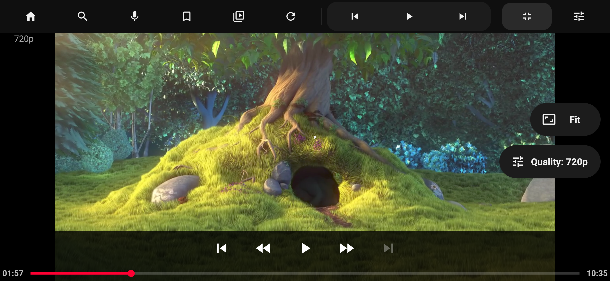
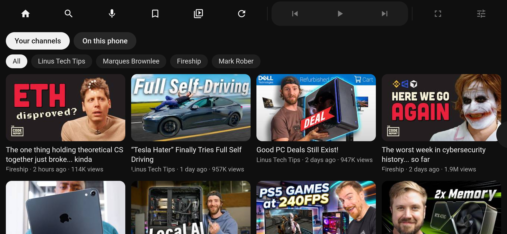
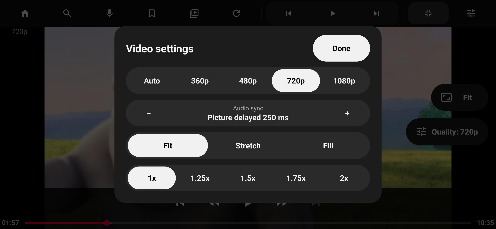
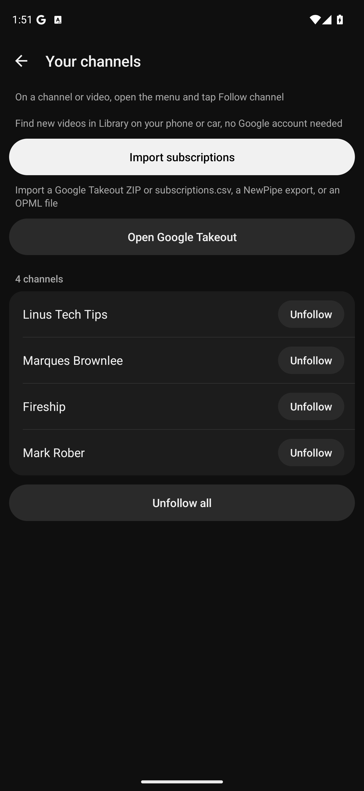
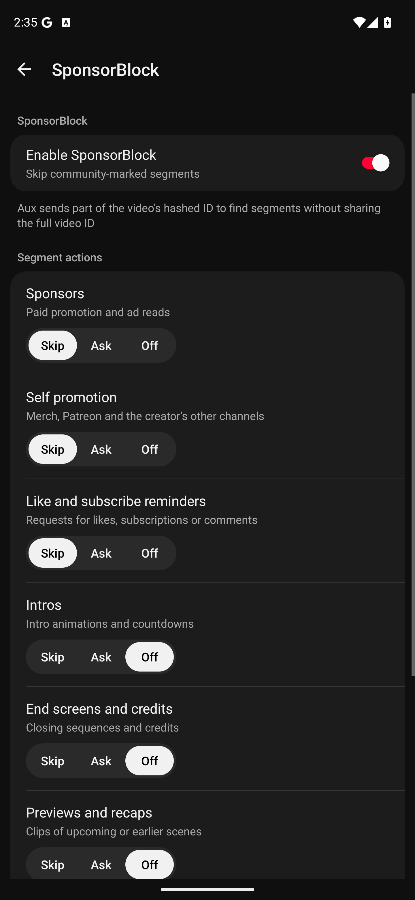

# Aux

Watch YouTube, follow your favorite channels, and play videos from your phone, Jellyfin or Plex on Android Auto

Aux is free and open source, with ad blocking and SponsorBlock built in, and you don't need a Google account to watch public YouTube videos

[Download Aux Setup](https://github.com/Syaviii/Aux/releases/latest)

## What you can do

- Follow YouTube channels without signing in, or import your subscriptions from Google Takeout, NewPipe or OPML
- Play local videos and browse your Jellyfin or Plex library, then resume where you left off
- Skip sponsors automatically with SponsorBlock, or choose when to skip
- Watch in fullscreen with captions, chapters, playback speed and video quality controls
- Pick videos and queue up the next one from your phone while Aux plays on the car screen
- Control playback from your steering wheel, notification or lock screen
- Keep audio playing while you use Maps and use data saver on mobile connections

| Your library | Video controls |
|---|---|
|  |  |

| Phone remote | Followed channels | SponsorBlock |
|---|---|---|
|  |  |  |

## Install

Requires Android 8 or later

1. Download and install [Aux Setup](https://github.com/Syaviii/Aux/releases/latest) on your phone
2. Open it, tap **Install Aux**, and allow the microphone for voice search
3. Reconnect to Android Auto and open Aux on the car screen

Keep Aux Setup installed for updates, and use **Fix Aux for Android Auto** if Aux doesn't appear in your car's app list

Usage reporting is on by default to help improve Aux. Reports include app and Android versions, phone model, country, car use and error counts. Vehicle and head unit details are optional. Turn it off in **Settings > Share usage**; watch history is never sent

## Vehicle compatibility

| Vehicle | Video | Audio | Fullscreen | Phone remote | Steering-wheel controls | Background audio |
|---|---|---|---|---|---|---|
| 2021 Kia K5 | ✅ | ✅ | 🟨 | ✅ | ✅ | ✅ |
| 2025 Ford Bronco Sport | ✅ | ✅ | ✅ | ✅ | ❔ | ✅ |
| 2021 Ford Edge | ✅ | ✅ | ✅\* | ✅ | ❔ | ❔ |

Owner reports: ✅ Fully working / 🟨 Working with quirks / ❔ Untested

On the Kia K5, fullscreen's top control bar squeezes the skip buttons and makes them small

\* On the 2021 Ford Edge's vertical screen, fullscreen hides navigation, so navigation and video can't be shown together

## License

Aux is licensed under [GPL 3.0 or later](LICENSE)
